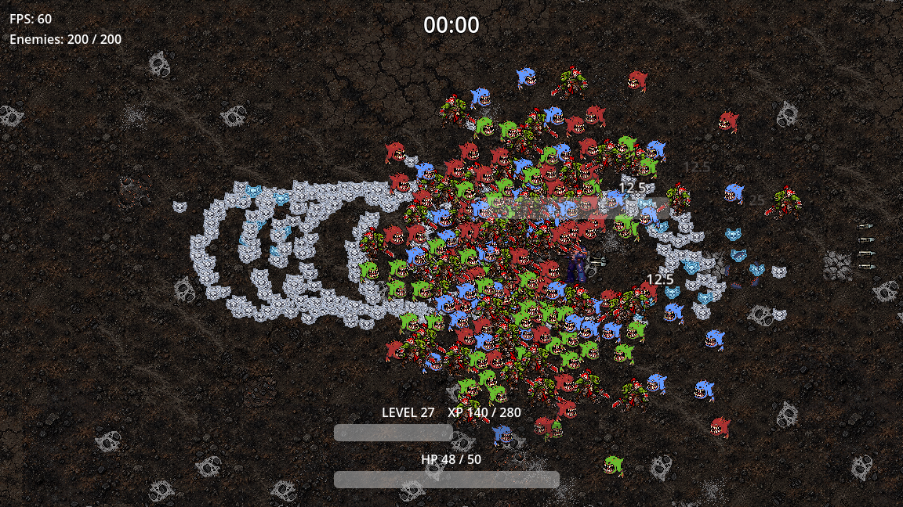
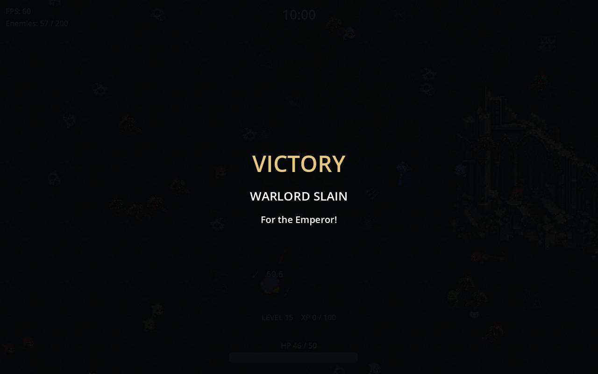

# WH40K Survivors Prototype

A playable, top-down 2D survivor-game prototype built in Godot 4 with GDScript. Move through a streamed battlefield, fight enemy swarms, collect XP and choose upgrades before a boss encounter.

**[Source](https://github.com/IvLatkov/wh40k-survivors-prototype) · [CI runs](https://github.com/IvLatkov/wh40k-survivors-prototype/actions/workflows/ci.yml) · [Companion project tracker: No-Te](https://github.com/IvLatkov/no-te)**

This is an unofficial personal learning project inspired by Warhammer 40,000, not an official or licensed Games Workshop release.



*Captured from the rendered combat benchmark with a 200-enemy target and fixture-specific upgrades. This is a stress scenario, not the starting state or a promise of gameplay performance.*



*Captured victory state from the boss playthrough fixture. These repository captures document development; individual visuals may change as the prototype evolves.*

## Why I built it

I enjoy survivor games and wanted to turn my own gameplay ideas into something playable while learning game development. The project gives me a concrete way to work on combat feel, progression, balancing, bug reproduction and performance testing rather than learning each topic in isolation.

The aim is a small playable prototype with understandable systems, not a finished commercial game. I track its requirements, tasks and implementation notes in [No-Te](https://github.com/IvLatkov/no-te).

## Implemented gameplay

- **Movement and combat:** keyboard movement, mouse-directed aiming, automatic ranged fire, melee attacks, splash damage, critical hits and floating damage feedback.
- **Enemies:** Squigs and Orks with timed spawning, swarm separation, melee wind-up/attack/recovery behavior, local obstacle steering and clearance checks for spawn positions.
- **Progression:** XP pickups, level-up choices, weapon and passive upgrades, upgrade limits and weapon ultimates.
- **Player information:** health, armor, damage and other character statistics.
- **World:** deterministic procedural terrain, chunk streaming, roads, ruins and solid terrain props.
- **Boss:** a Warboss encounter beginning around ten minutes, with claw and ranged attacks and a victory state. Ordinary spawning stops once the boss is successfully placed; existing enemies remain.
- **Presentation:** pixel-art sprites, combat effects and looping background audio.

### Controls

| Input | Action |
| --- | --- |
| WASD / arrow keys | Move |
| Mouse | Aim |
| I | Open character information |
| F10 in debug builds | Advance to the boss encounter through the normal encounter controller |

The boss shortcut is a development aid; it is not a separate boss implementation or a release-build feature.

## My role and use of AI

I set the gameplay direction, define mechanics and acceptance criteria, choose balance values, playtest builds, report problems and decide which changes to keep. I also organize the project and track fixes, test results and design decisions.

Implementation is substantially AI-assisted. Codex generates and revises much of the GDScript, helps structure tests, investigates bugs and assists with profiling and documentation. I use screenshots, error output and playtesting observations to direct that work. Some visual assets were also created with generative AI; this is not a claim that I hand-drew every sprite or wrote every line unaided.

My focus is learning to connect requirements to observable behavior, compare proposed changes with actual gameplay, and understand the systems well enough to discuss their decisions and limitations honestly. Test scripts, performance reports and documentation provide concrete starting points for that discussion.

## Important decisions and engineering work

| Area | Decision and evidence |
| --- | --- |
| Swarm movement | A spatial grid limits nearby separation queries. Small local obstacle detours handle current terrain without a global navigation system. [Navigation report](docs/enemy_obstacle_navigation.md) |
| Readable enemy attacks | Ork melee separates chase, preparation, impact and recovery so movement can avoid a committed attack. [Melee design](docs/ork_melee.md) |
| Combat feedback | Scene-owned pools reuse blood effects and damage numbers to reduce allocation bursts during mass enemy deaths. [Combat profiling](docs/combat_performance.md) |
| Terrain streaming | Incremental generation and prefetching spread terrain work while preserving seeded generation. [Streaming report](docs/terrain_streaming_performance.md) |
| Balancing | Weapon/passive choices, XP progression and timed enemy mixes are adjusted through repeated playtesting. Behavior tests help separate a balance change from an unintended regression. [Progression tests](tests/xp_progression_test.gd) |
| Scope | Scene composition, signals and focused scripts keep the prototype manageable. A full world-navigation framework and speculative abstractions are deliberately deferred. [Development guidelines](AGENTS.md) |

### Performance evidence, with context

Performance varies substantially by renderer and test scenario. The repository contains measurements rather than one headline FPS claim.

| Recorded scenario | Result | Interpretation |
| --- | --- | --- |
| Earlier rendered combat optimization, Godot 4.6.3 / D3D12 Forward+ / RX 5700 XT | p95 frame interval improved from 29.812 ms to 22.758 ms; worst from 65.014 ms to 37.063 ms | Fewer large spikes in that fixture. The stated p95 <20 ms and worst <33 ms targets were still not met. |
| Terrain streaming, final 200-enemy fixture | Transition CPU work averaged 2.990 ms, worst 6.328 ms | Measures a particular streaming workload; it is not an overall gameplay FPS guarantee. |
| Later obstacle-navigation stress profile, compatibility renderer, roughly 197 active enemies | Recorded average 16.81 FPS | Dense stress scenarios remain a performance limitation. This run uses different rendering/profiling conditions and is not directly comparable with the earlier combat result. |

Read the linked reports for hardware, fixtures, raw JSON, methodology and caveats. Headless behavior checks are not rendered FPS benchmarks, and an average near 60 FPS does not mean every frame meets its budget.

## Technologies

- Godot **4.6.3** standard editor, GDScript, reusable scenes, resources and signals.
- Godot 2D physics and collision queries, TileMapLayer-based terrain and streamed chunks.
- Pixelorama for pixel-art editing; generative AI for some visual resources.
- Git, GitHub and Git LFS for source audio; GitHub Actions for the selected headless regression suite.
- Codex for assisted implementation, investigation, tests and documentation; No-Te for project tracking.

## Run locally

Install Godot **4.6.3** and Git LFS. The project uses GDScript; the .NET editor is not required. The commands below assume the Godot executable is available as `godot` on your PATH.

```sh
git lfs install
git clone https://github.com/IvLatkov/wh40k-survivors-prototype.git
cd wh40k-survivors-prototype
git lfs pull
godot --editor --path .
```

Alternatively, import `project.godot` from the Godot Project Manager. Let asset importing finish, then press **F5** to run the main scene. Source WAV files are stored in LFS: if audio files contain only pointer text after cloning, complete `git lfs pull` before opening the project.

Development has focused on Windows. The project selects the Forward+ feature set and D3D12 on Windows; verify renderer compatibility on your own hardware. Other platforms are not claimed to have equivalent coverage.

## Tests and verification

```sh
# Import assets and check the project in headless editor mode.
godot --headless --path . --editor --quit

# Run the selected CI suite.
godot --headless --path . --script tests/run_ci_tests.gd

# Run focused obstacle and boss regressions.
godot --headless --path . --script tests/enemy_obstacle_navigation_test.gd
godot --headless --path . --script tests/warboss_encounter_test.gd
```

The [CI runner](tests/run_ci_tests.gd) currently selects **seven test scripts** covering XP progression, armor, Ork spawning, combat optimization, ultimate upgrades, XP pickup visuals and terrain trees. Seven scripts is not a claim that the entire `tests/` directory runs in CI. More focused behavior and rendered preview scripts are available for manual/local use.

The [recorded CI run for commit `0369a28`](https://github.com/IvLatkov/wh40k-survivors-prototype/actions/runs/43749182451) succeeded. It imports the project, runs the selected suite and checks the generated asset catalog. This README update does not claim a new gameplay test run. Rendered playtesting and performance checks remain separate from headless CI.

## Current progress and limitations

The core combat/progression loop, streamed world and first boss are playable. The project is still a prototype: content, balance, readability and performance continue to change.

- Local obstacle steering handles the current props and small clusters; it is not general pathfinding for arbitrary mazes or long connected walls.
- High-density combat can still miss frame-time targets, particularly in the recent compatibility-renderer stress fixture.
- Automated scripts cover specific cases. They do not replace full playthroughs, usability feedback or testing on other hardware.
- There is no packaged public release or gameplay video linked here yet; the screenshots are actual development captures.

## Theme, assets and permissions

Warhammer 40,000 and associated names/settings belong to their respective rights holders. This project is not affiliated with or endorsed by Games Workshop, and the unofficial label is not a license to use its IP.

Artwork/audio are prototype resources; a complete asset provenance and redistribution-permissions inventory is still outstanding. The repository has no root open-source license. Do not assume that public source visibility grants permission to reuse every asset or to redistribute a commercial game based on this project.
