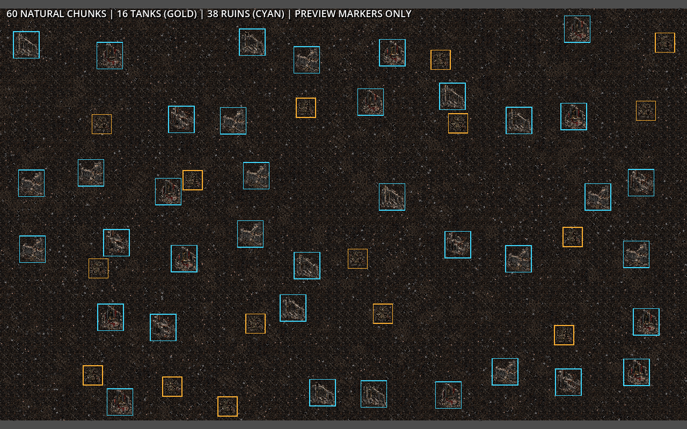
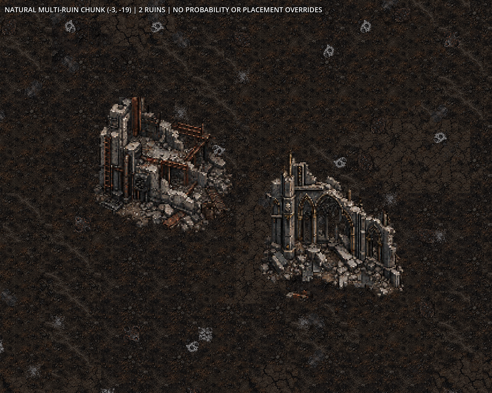
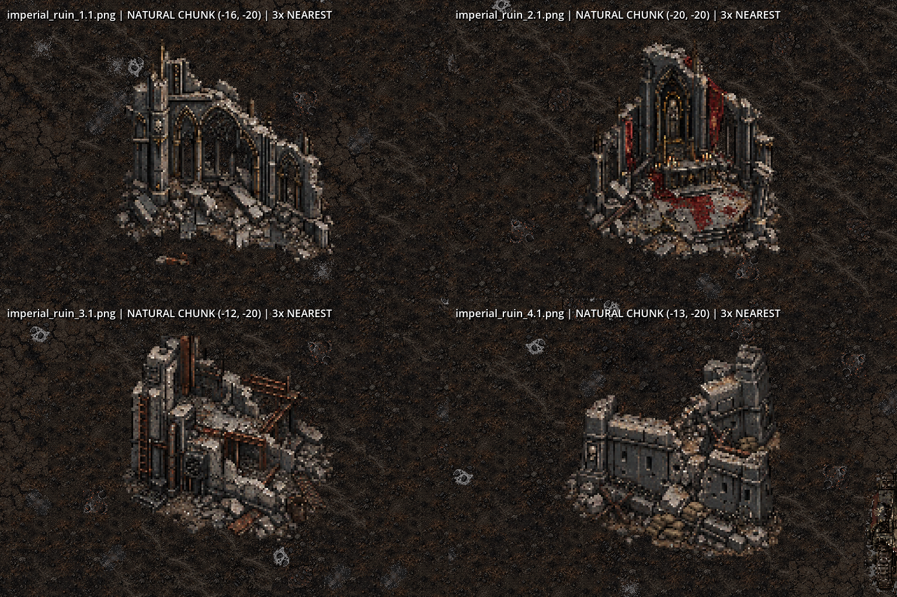
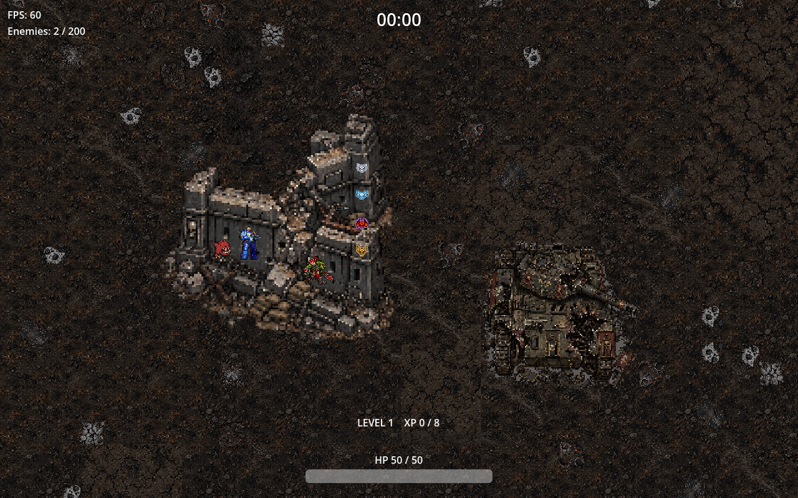

# Independent building ruin spawn rolls

Updated 2026-10-31. This supersedes the previous single 20% roll / one selected variant implementation. No commits or pushes.

## Current rule and assets

Every one of the four supplied textures now has **its own independent 25% spawn roll per eligible chunk**. There is no global building gate and no one-of-four selection roll. A chunk can have zero to four successful rolls, with at most one instance of each texture. Successful candidates can still be rejected by safety/overlap constraints. One unchanged tank may coexist.

Actual source files, dimensions and measured results over **10,000 eligible 1024px chunk coordinates (-50..49 in each axis)**:

| PNG | Native size | Successful rolls | Roll frequency/chunk | Placed | Placed frequency/chunk | Skipped |
|---|---|---:|---:|---:|---:|---:|
| imperial_ruin_1.1.png | 128 x 132 | 2473 | 24.73% | 1300 | 13.00% | 1173 |
| imperial_ruin_2.1.png | 128 x 128 | 2502 | 25.02% | 1336 | 13.36% | 1166 |
| imperial_ruin_3.1.png | 128 x 128 | 2501 | 25.01% | 1361 | 13.61% | 1140 |
| imperial_ruin_4.1.png | 128 x 130 | 2523 | 25.23% | 1352 | 13.52% | 1171 |

All four PNG byte hashes remain identical to the supplied originals. They are transparent RGBA, use lossless imports without mipmaps, and are preloaded/shared. No image edit, new artwork, cropping, texture resizing, dynamic texture generation or unique material was introduced. Source PNGs remain unchanged.

## Distribution after placement constraints

**9,999 total successful rolls**, **5,349 placed ruins**, **0.5349 placed buildings per chunk**. Raw roll success frequencies trend toward 25% for each texture independently. Placed frequencies are lower because of the large 3x artwork and required spacing.

| Number in a chunk | Successful rolls before rejection | Final placed-building chunks | Final chunk percentage |
|---:|---:|---:|---:|
| 0 | 3167 | 4758 | 47.58% |
| 1 | 4214 | 5136 | 51.36% |
| 2 | 2107 | 105 | 1.05% |
| 3 | 477 | 1 | 0.01% |
| 4 | 35 | 0 | 0.00% |

All four rolls passed together in **35** chunks. No four-building chunk survived geometric rejection in this sample; this is an overlap-limited outcome, not a hidden single-building cap. There are **105 two-building chunks** and **one three-building chunk**. Candidate generation and node creation support all four. The test checks all 16 roll combinations against the expected independent Bernoulli probabilities.

**4,650 successful rolls were skipped**, assigned to their first applicable constraint:

- Start-area clearance: **1**.
- Tank overlap: **2,619**.
- Overlap with an earlier accepted building: **2,030**.

The fully instantiated 512-chunk secondary sample produced 292 ruins, variant counts [68,73,73,78], with 0/1/2/3/4-building chunk counts [225,282,5,0,0]. This is a smaller fixed sample; exact percentages vary.

## Determinism and overlap policy

Each texture has its own coordinate/variant seed: `hash(Vector4i(chunk_x, chunk_y, 0x5255494E, variant_index))`. Position draws stay within that stream. Whether another texture passes, fails or is rejected cannot affect its spawn roll or position. Global gameplay RNG is untouched.

Placement priority rotates deterministically by chunk using a separate `0x4F524452` salt. This prevents the same texture from always winning conflicts; it does not change any spawn roll or candidate position. After a successful roll:

1. Reject if the full conservative footprint enters the starting-area disk.
2. Reject if it intersects the tank footprint plus its spacing gap.
3. Reject if it intersects an already accepted building footprint plus its spacing gap.
4. Otherwise create the static sprite.

There is **no reroll, relocation attempt, unbounded retry or physics query**. The previous tank-avoidance corner relocation has been replaced by deterministic rejection, matching the new request. Tests require every placed position to match its original candidate exactly and every skipped candidate to have a real conflict.

## Geometry and rendering

- Existing **3x integer scale**, nearest filtering, original orientation, **no flips/rotations**. Display dimensions are 384x384..396 world pixels.
- Common conservative footprint **384x396**, covering every supplied texture without variant-dependent safety advantages.
- **256px minimum center margin**. In 1024px chunks, centers lie within 256..768, leaving at least **64px horizontal / 58px vertical** full-art clearance. Undersized chunks skip safely.
- **300px starting clearance** from the entire footprint around the actual terrain origin (0,0).
- **32px gap** for both tank/building and building/building rectangles. Props in adjacent chunks cannot overlap because every full footprint stays inside its own chunk.
- Existing `LargeProps` relative z-index **2**, effective z-index **-8**, above Ground (-10) and Decorations (-9), below XP (-1), actors/projectiles (their unchanged layers), combat VFX and UI.
- Nodes are named `BuildingRuin1`..`BuildingRuin4`, plus the unchanged `TankWreck`; maximum five large-prop sprites per chunk. No extra scene hierarchy is needed.
- No collision bodies, Areas, shapes, navigation obstruction, spawn blockers or per-frame prop scripts. Gameplay actors may pass through as requested.

## Regression results

The updated building test passed **99,467 checks** across 10,000 placement coordinates and 512 fully instantiated/reconfigured chunks. It verifies independent rolls, all joint roll combinations, exact rejection accounting, deterministic reload/order/position, unchanged image bytes, no overlap, no duplicates, native source/scale, and no physics/navigation/material/per-frame callbacks.

All **400 pre-building ground hashes, decoration hashes and tank positions** remain identical. Tank chance is still **35%**, with **3,523 tanks in the same 10,000-coordinate sample**. The tile 4 decoration base probability remains **0.007** with the unchanged normalization; excluded tiles 7,8,9,10,13 remain excluded. The tank function, source asset hashes, ground and decoration generation source are checked again at completion.

All **33 functional regression scripts passed**. Rendered editor import/parser validation and main-project smoke testing completed without errors or shutdown warnings. Original terrain and current decoration reference hashes, incremental preparation, prefetch, spatial-grid combat, spawn schedules, XP and upgrade tests are included. Chunk manager and streaming architecture were not edited.

## Preview inspection

The rendered 60-chunk overview contains **38 buildings** (per-type [9,12,6,11]) and **16 unchanged tanks**. Its final 0/1/2/3/4-building histogram is [22,38,0,0,0]. These are natural placements with no probability overrides. Gold/cyan outlines are preview-only markers.

A separate natural multi-ruin close-up at **(-3,-19)** shows two buildings from the same chunk without forcing rolls or moving the candidates. The variant gallery shows all four source artworks. The real-main-scene readability fixture uses natural tank/building coexistence at **(-13,-20)** and displays a player, Squig, Ork, four XP tiers and a bolt over/near the ruin. Camera/static actor setup is test-only; no gameplay actor is recolored.

I inspected all previews: complete artwork stays inside chunk bounds, tank/building/building footprints do not stack, open terrain remains dominant, and actors/XP/projectile remain visible above the props. Preview screenshots are not FPS benchmark measurements.









## Performance and implementation scope

The only production script edited is `scripts/systems/terrain_chunk.gd`. It adds four bounded independent rolls and at most six building-pair overlap comparisons per newly generated chunk. There is no per-frame building work. Empty attempt lists return before tank-overlap work. All four textures and existing TileSets stay shared. Ground/decor preparation and the 3x3 active grid/cache remain unchanged.

The rendered baseline was recorded using the previous single-building rule, before changing it: 48 transitions, 40 approach frames each, 200 enemies, `--fixed-fps 60 --stress --profile --tank-route`, Godot 4.6.3 / D3D12 Forward+ / RX 5700 XT. Transition CPU averaged **3.0535ms**, worst **5.181ms**; normal frames averaged **16.664028ms** (~60.01 FPS); crossing p95 **19.250ms**, worst **20.377ms**; prepared-cache peak **7**. With independent rolls, the final rendered run measured **3.086729ms mean / 4.035ms worst transition CPU**; normal frames **16.663061ms (~60.01 FPS)**; crossing p95 **19.546ms**, worst **19.777ms**; prefetch worst **1.786ms**, cache peak **7**, and 200 enemies at the end. Buildings/tanks were active in all **48/48** windows, peaking at **6 buildings / 3 tanks** across the nine loaded chunks. The mean CPU difference from baseline is about **0.033ms**; this sample shows no material streaming regression. Worst samples naturally fluctuate; this is not a zero-cost or universal frame-budget guarantee.

## Reproduce

```powershell
C:/Godot/Godot_console.exe --headless --path . --script tests/terrain_building_test.gd
C:/Godot/Godot_console.exe --headless --path . --script tests/terrain_determinism_test.gd
C:/Godot/Godot_console.exe --path . --script tests/building_terrain_preview.gd
C:/Godot/Godot_console.exe --path . --fixed-fps 60 --script tests/terrain_streaming_performance_test.gd -- --stress --profile --tank-route
```

Headless test throughput is not rendered FPS. Full statistics are in `building_distribution.json`; per-script regression output is in `building_regressions.json`.

## Files

- Runtime update: `scripts/systems/terrain_chunk.gd` only. No scene, chunk-manager, actor, weapon, pickup or gameplay scripts changed.
- Updated tests/tooling: `tests/terrain_building_test.gd`, `tests/building_terrain_preview.gd`, `tests/terrain_tank_test.gd`, `tests/terrain_streaming_performance_test.gd` (counts all ruin sprites). The tank test now permits one tank plus four ruins. Earlier pending `tests/tank_terrain_preview.gd` changes remain intact.
- Updated evidence: this report, `docs/building_distribution.json`, `docs/building_regressions.json`, the overview/variant/readability PNGs; new `docs/building_multiple.png` and import metadata.
- Previously added building test UID/baseline and provided PNG/import files remain uncommitted from the preceding task. The original PNGs and baseline were not edited in this follow-up.

No commits or pushes.
