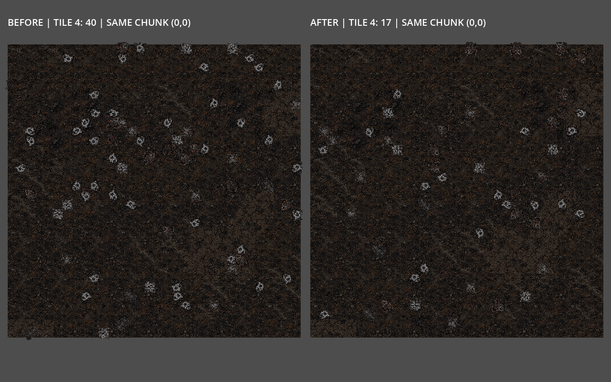

# Decoration tile 4 probability adjustment

2026-10-31. The sole production behavior change in this follow-up is the base probability for `dark_dirt_ash_tile_4.png`: **0.020 -> 0.007** (a 65% reduction). The fixed normalization `0.0705 / 0.0515` is unchanged, so the absolute per-cell chance is **2.73786408% -> 0.95825243%**. All seven other probabilities remain exactly unchanged.

The generator already builds cumulative thresholds by adding each active category in array order. Reducing one positive width automatically shifts subsequent thresholds without creating a gap. Total decoration probability falls from **6.70776699% to 4.92815534%**; the remaining **95.07184466%** is the intentional no-decoration result, not a dead category interval. No other category receives the removed probability.

## Measured deterministic distribution

Identical 20 x 20 chunk coordinates, x/y -10..9: **400 generated chunks, 409,600 cells**. Before counts were recorded from the actual implementation before editing. All percentages below are per terrain cell, not shares of decorations.

| Active file | Configured before % | Configured after % | Before count | After count | Observed after % |
|---|---:|---:|---:|---:|---:|
| dark_dirt_ash_tile.png | 0.54757282 | 0.54757282 | 2288 | 2297 | 0.56079102 |
| dark_dirt_ash_tile_2.png | 0.54757282 | 0.54757282 | 2147 | 2157 | 0.52661133 |
| dark_dirt_ash_tile_3.png | 0.68446602 | 0.68446602 | 2789 | 2786 | 0.68017578 |
| dark_dirt_ash_tile_4.png | 2.73786408 | 0.95825243 | 11200 | 3952 | 0.96484375 |
| dark_dirt_ash_tile_5.png | 0.41067961 | 0.41067961 | 1614 | 1631 | 0.39819336 |
| dark_dirt_ash_tile_6.png | 0.41067961 | 0.41067961 | 1746 | 1689 | 0.41235352 |
| dark_dirt_ash_tile_11.png | 0.68446602 | 0.68446602 | 2830 | 2747 | 0.67065430 |
| dark_dirt_ash_tile_12.png | 0.68446602 | 0.68446602 | 2856 | 2746 | 0.67041016 |

Tile 4 observed frequency: **2.73437500% -> 0.96484375%**, an observed **64.71429% reduction** (remaining frequency 35.28571% of baseline). It remains present 3952 times in this sample.

Every other configured probability is unchanged. Their finite-sample counts differ slightly because transforms consume three conditional RNG draws after a successful decoration. Reducing the number of successes therefore shifts subsequent draws; the original draw order, traversal order and transform logic were retained, with no extra draws or RNG stream added. Exact old decoration positions are not preserved or claimed. Returning to a coordinate still produces the same new layout.

## Validation

- New distribution test verifies all active chances are positive, cumulative intervals are contiguous/in bounds, tile 4 is exactly 35% of its old probability and every other probability matches the recorded baseline. All eight categories appear.
- Across all 400 coordinates, ground array bytes and tank positions match the before snapshot. Every coordinate is generated again and incrementally, checking exact repeated/incremental ground and decoration data.
- The 25 original ground TileMap reference hashes remain untouched and pass. New weight-specific decoration hashes are recorded separately in `tests/terrain_decoration_reference_hashes.json` and pass the normal determinism test. The original combined reference file remains unchanged as historical evidence.
- Terrain artwork/whitelist checks pass. Runtime exclusions remain tile 7, 8, 9, 10 and 13; no files were added to or removed from the active decoration list.
- Tank checks pass: 16,700 assertions, still 20% configured chance / 2,086 of 10,000 coordinates, no collision, same margins/clearance/orientation.
- Prefetch checks and all 901 terrain streaming assertions pass. Chunk manager and streaming architecture were not edited.
- Before/after preview was rendered and inspected. Same chunk (0,0), identical ground and tank placement, tile 4 count **40 -> 17**; a single chunk varies more than the full sample.
- Rendered editor import/parser and main-project smoke tests were run.



## Reproduce

```powershell
C:/Godot/Godot_console.exe --headless --path . --script tests/decoration_distribution_test.gd
C:/Godot/Godot_console.exe --path . --script tests/decoration_distribution_test.gd -- --capture
C:/Godot/Godot_console.exe --headless --path . --script tests/terrain_determinism_test.gd
```

The baseline-record option intentionally requires the original probability and cannot overwrite the old snapshot under the new setting. Reference-recording is explicit; normal tests only read expected references.

## Files changed in this follow-up

- `scripts/systems/terrain_chunk.gd`: one probability and its explanatory total-density comment; earlier uncommitted tank work is retained.
- `tests/terrain_artwork_test.gd`: updated total probability/density assertions.
- `tests/terrain_determinism_test.gd`: separate weight-specific decoration references; original ground assertions retained.
- `tests/decoration_distribution_test.gd` and its UID: paired before/after distribution/invariance test and optional rendered comparison.
- `tests/decoration_distribution_baseline.json`: measured old sample and hashes.
- `tests/terrain_decoration_reference_hashes.json`: new decoration hashes for 25 existing reference coordinates.
- `docs/decoration_distribution_after.json`: measured new sample and hashes.
- This report and `docs/decoration_weight_preview.png` plus import metadata.

No ground-generation, tank, streaming, gameplay or asset changes were made in this follow-up. No commits or pushes.
