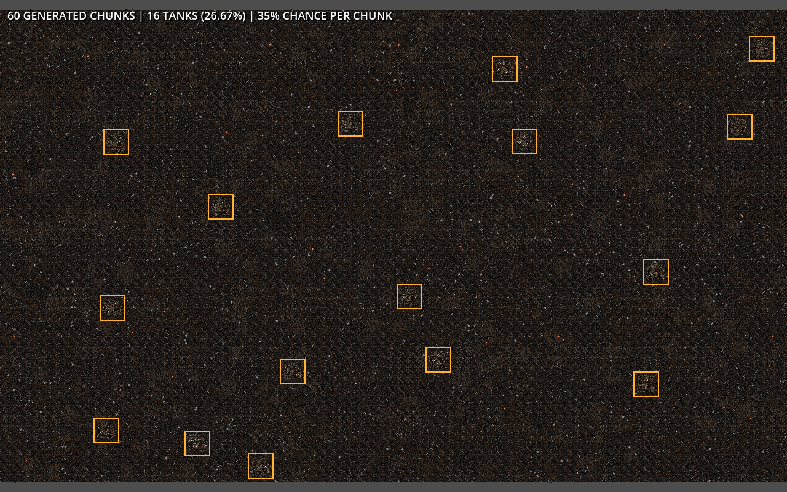
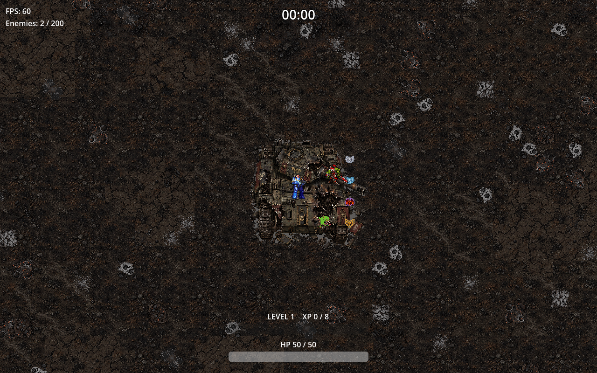

# Rare tank terrain prop

## Current frequency: 35% (2026-10-31)

This follow-up changes exactly one production-code constant: `TANK_CHANCE: 0.20 -> 0.35`. Comparing the complete production source against its pre-task snapshot confirmed that no other code changed. Tank asset SHA-256 is unchanged. Maximum one per chunk, RNG stream/salt, position calculation, margins, starting clearance, 2x scale, no flip/rotation, z-order, no collision and streaming architecture remain intact.

Current deterministic samples: **16 tanks / 60 rendered chunks (26.67%)**, **33 / 100 fully generated chunks (33.00%)**, **3,523 / 10,000 coordinates (35.23%)**. Small samples naturally differ from the configured probability. Existing preview tooling was run without probability overrides; its caption automatically displays 35%.

Verification: **21,047 tank checks**, all **25 original ground/current decoration reference coordinates**, and prefetch tests passed. A paired 400-chunk check confirmed every ground and decoration hash and all decoration counts/probabilities are unchanged from before this follow-up. All **67 previously present tanks** in that sample retain identical positions, with the new total **117** after additional chunks become eligible. The decoration test's historical 20% tank assertion was updated to allow newly added tanks while still checking exact positions of previously present ones. Production decoration code was not edited.

The rendered 200-enemy streaming benchmark ran **48 transitions**, with tanks active in **48/48 windows** and peak **3 active tanks** in the nine-chunk grid. Transition CPU: **3.036604ms mean / 4.193ms worst**. Normal frame mean: **16.665239ms (~60.01 FPS)**; crossing-frame p95 **19.207ms**, crossing worst **19.711ms**; prepared-cache peak **7**. Streaming remains acceptable. Main-project smoke testing completed without runtime/debugger errors or shutdown warnings.

Files changed in this follow-up: `scripts/systems/terrain_chunk.gd`, `tests/terrain_tank_test.gd`, `tests/decoration_distribution_test.gd`, this report, regenerated `docs/decoration_distribution_after.json` (ground/decoration fields unchanged; tank fields refreshed), `tank_terrain_overview.png` and `tank_terrain_detail.png`. No asset changes, commits or pushes.


## Previous frequency-only update: 20% (historical, 2026-10-31)

The only runtime change in this follow-up is `TANK_CHANCE: 0.05 -> 0.20`. Asset bytes, position generation/RNG salt, 192px center margin, whole-footprint 250px starting clearance, scale, orientation, z-order, one-per-chunk cap, no-collision behavior and streaming architecture are unchanged. The frequency assertion and preview caption were updated; the caption now reads the configured chance rather than hardcoding it.

The regenerated 60-chunk preview contains **7 tanks (11.67%)**. A separate 100 fully generated chunk sample contains **15 tanks (15%)**. The 10,000-coordinate deterministic sample contains **2,086 tanks (20.86%)**. Small fixed samples naturally differ from the configured chance; no placement rule was changed to force them to match.

Focused verification passed: **16,700 tank checks**, **25 unchanged ground/decoration reference coordinates** (including incremental generation), and **901 streaming checks**. The existing rendered overview/detail preview and main-project smoke test ran successfully. The previously reported complete suite is historical; this frequency-only update reran these focused checks.

Rendered tank-route streaming benchmark: **200 enemies**, **48 transitions**, tank present in **42/48 windows**, peak **2 active tanks** across the nine chunks. Mean transition CPU **3.048854ms**, worst **4.559ms**; normal frame mean **16.661805ms** (~60.02 FPS); crossing-frame p95 **19.261ms**, worst **19.706ms**; prepared-cache peak **7**. Performance remains acceptable; compared with the prior 5% tank route (2.969ms mean), the small difference does not establish a meaningful regression from a single run. No debugger/runtime errors or shutdown warnings occurred.

Files changed in this follow-up: `scripts/systems/terrain_chunk.gd`, `tests/terrain_tank_test.gd`, `tests/tank_terrain_preview.gd`, this report, `tank_terrain_overview.png` and `tank_terrain_detail.png`. The existing tank PNG SHA-256 remains `8ed9e28e7ca14bc7a25f0decd4f5e2fa10808204bbcf2f6d82d1a62f45a7dee5`. No commits or pushes.


Implemented 2026-10-31 using the supplied `assets/art/effects/terrain/tanks/tank1.png`.

## Asset preparation

The source is 128 x 128, 8-bit RGBA. Inspection found that every source pixel was fully opaque, including a gray background. After the user explicitly confirmed that the gray background should be transparent, an offline, border-connected color flood fill changed only alpha values. 5,287 of 16,384 pixels became transparent. Every RGB byte and the native dimensions were verified unchanged. No replacement artwork, AI image generation, resampling, recoloring or runtime texture processing was used.

The flood fill was limited to border-connected pixels within three channel values of RGB (96, 93, 91). Internal disconnected details were retained. Original file SHA-256: `00d0b6fa911fef2bf689b7242e3ed88c94860f1c7fdb956babe416cb3458da0d`; prepared file SHA-256: `8ed9e28e7ca14bc7a25f0decd4f5e2fa10808204bbcf2f6d82d1a62f45a7dee5`.

Godot imports it losslessly (`compress/mode=0`), without mipmaps or a size limit. Terrain's existing nearest-neighbor filter is inherited. Sprite scale is an integer 2x, displaying the native artwork at 256 x 256 world pixels; this does not resize the texture.

## Placement and layering

- `TerrainChunk` has a `LargeProps` Node2D sibling after Ground and Decorations. It contains zero or one Sprite2D, uses the shared preloaded texture, and has no processing callbacks, physics bodies, areas, shapes or navigation obstruction.
- Probability is 35% per chunk (updated from 20%; originally 5%). A separate RandomNumberGenerator seeded by `hash(Vector3i(chunk_x, chunk_y, 0x54414E4B))` owns the tank roll and position. Ground and decoration generation, RNG calls and prepared-data structures are untouched. Global gameplay RNG is not consumed.
- Center coordinates are integer-aligned within 192..832 on both axes for a 1024px chunk. At 2x scale, this leaves at least 64px between the full texture footprint and the nearest chunk edge. The implementation also guards smaller configured chunks and skips those too small to fit comfortably.
- The **whole texture footprint** stays outside a 250px disk around the actual starting terrain origin (0,0). This is more conservative than center-only clearance. A conflicting candidate is skipped once, without rerolling. The origin is the existing main scene's start, not the current moving player position.
- Original orientation is retained, with no horizontal/vertical flip or rotation, preserving the art's lighting and barrel direction.
- Relative LargeProps z-index is 2. Under the existing TerrainChunks z-index -10, Ground is -10, Decorations -9 and tanks -8. Pickups are -1 (shadows -2), player/enemies 0, and combat VFX/UI remain above. Actors can walk straight across the visual wreck.
- Reconfiguration replaces the old visual immediately, and unloading/reloading a coordinate reproduces the same placement. The old landmark system is not restored.

## Density and visual preview

| Sample | Tanks | Frequency |
|---|---:|---:|
| 10,000 deterministic coordinates (-50..49 in each axis) | 3,523 | 35.23% |
| 100 fully generated chunks (-5..4 in each axis) | 33 | 33.00% |
| 60 fully rendered chunks (10 x 6) | 16 | 26.67% |

The smaller samples are naturally underpopulated; no probability boost was used for screenshots. The overview marks the naturally generated wreck with a gold outline solely for inspection. The detail screenshot uses that same eligible coordinate in the normal main scene with a player, Squig, Ork and all four XP tiers overlapping/adjacent to the wreck. The framing camera and actor placement are preview-only. Tank edges, terrain blending, actor overlap and XP outlines/shadows/tier colors were visually inspected. No gray background square remains.





## Verification

For the original implementation, all 31 functional `*test.gd` scripts passed; individual results are in `tank_regressions.json`. In particular:

- 11,979 new tank checks cover density, exact placement repeatability, no global RNG consumption, bounds, whole-footprint start clearance, at-most-one prop, texture reuse, no collision, original orientation, layer order, small-chunk behavior, live reconfiguration and reload.
- All 25 existing terrain reference coordinates match the original ground and current small-decoration TileMap bytes, including incremental generation. Excluded decoration filenames remain excluded.
- Existing streaming/prefetch tests retain the nine active chunks, overlap reuse and prepared-cache limit. The two old assertions that expected exactly two terrain children now expect the requested third LargeProps child.
- Existing player/Ork/Squig combat, spawn schedules, XP readability/values/collection, upgrades and UI tests passed. These production systems were not edited.
- Rendered editor import/parser validation, previews and main-project smoke tests were performed.

## Performance

No chunk-manager or streaming architecture code changed. The only production work is one deterministic roll per newly generated chunk and, rarely, one Sprite2D creation. Texture and TileSets remain shared; active radius, dimensions, prefetch distance/budget and cache limit are unchanged. There is no per-frame prop code.

The existing rendered stress benchmark uses Godot 4.6.3, D3D12 Forward+, RX 5700 XT, 200 live enemies, 48 terrain transitions and 40 approach frames per transition. The identical default route was measured before/after the original 5% implementation (historical baseline below). Values below are end-to-end CPU calls to `update_chunks`, not inferred GPU costs.

| Existing default route | Before | After repeat |
|---|---:|---:|
| Mean transition CPU ms | 2.986 | 2.992 |
| Worst transition CPU ms | 5.166 | 3.956 |
| Normal mean frame ms | 16.664 | 16.665 |
| Crossing p95 frame ms | 19.566 | 19.536 |
| Peak prepared cache | 7 | 7 |
| Active enemies at end | 200 | 200 |

The roughly 0.006ms mean difference is below useful run-to-run precision; there is no measurable regression in this sample. A first after run measured 2.978ms mean. Lower worst time is normal measurement variation, not a claimed terrain optimization. An isolated 500-sample headless recreation of an eligible prop measured 0.017836ms mean / 0.036ms peak; this measures CPU creation/cleanup, not GPU rendering.

A `--tank-route` fixture option starts at the naturally eligible chunk (1,-2), without overriding the probability. This also verifies streaming while an actual tank is present, rather than relying on a route that may contain no rare props. Final rendered results: a tank was active during 42 of 48 approach windows, with peak one active tank; 200 enemies remained active. Mean transition CPU was **2.969271ms**, worst **3.769ms**; normal frame mean **16.665103ms**, crossing-frame p95 **19.352ms**, crossing worst **19.404ms**, worst prefetch callback **1.692ms**, cache peak **7**, final displayed FPS **60**. This additional route differs from the default before/after route and is reported as a populated-scene check rather than a paired performance comparison. Rendered benchmark shutdown and the following main-project smoke run completed without errors or warnings.

The stress fixture could previously emit a shutdown-only ObjectDB leak warning when a level-up pause prevented pending explosion coroutines from finishing. Cleanup now disables the fixture, unpauses the tree, removes projectiles and drains timers outside every measured interval. Production explosion/combat code is unchanged. A verbose headless diagnostic completed without leak/error messages after this correction.

## Reproduce

```powershell
C:/Godot/Godot_console.exe --headless --path . --script tests/terrain_tank_test.gd
C:/Godot/Godot_console.exe --headless --path . --script tests/terrain_determinism_test.gd
C:/Godot/Godot_console.exe --path . --script tests/tank_terrain_preview.gd
C:/Godot/Godot_console.exe --path . --fixed-fps 60 --script tests/terrain_streaming_performance_test.gd -- --stress --profile --tank-route
```

Headless throughput is not a rendered FPS claim. The 60-chunk overview is a test-only visual sample, not a change to the normal 3x3 active grid.

## Files

Production: `scripts/systems/terrain_chunk.gd`, `scenes/systems/terrain_chunk.tscn`, the supplied `assets/art/effects/terrain/tanks/tank1.png` (approved alpha-only edit), and its Godot import metadata.

Tests: `tests/terrain_tank_test.gd`, `tests/tank_terrain_preview.gd` and their UIDs; `tests/terrain_artwork_test.gd`, `tests/terrain_chunk_streaming_test.gd` and `tests/terrain_streaming_performance_test.gd` (optional tank route and shutdown hygiene).

Evidence: this document, `tank_regressions.json`, `tank_terrain_overview.png`, `tank_terrain_detail.png` and image import metadata.

No commits or pushes were made.
